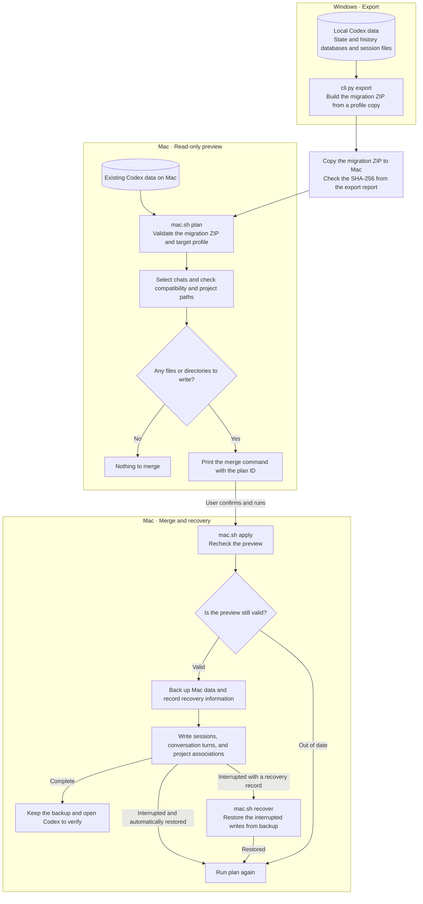

<div align="center">

# ChatLuggage

[简体中文](README.md) · **English**

**Bring your Codex chat history from Windows to Mac.**

[Getting started](#getting-started) · [Use cases](#use-cases) · [Features](#features) · [Migration flow](#migration-flow) · [Tech stack](#tech-stack) · [Project structure](#project-structure) · [MIT license](LICENSE)

</div>

## Overview

ChatLuggage merges local Codex chats and project associations from Windows into macOS while preserving the chats already on your Mac. Export, preview, and merge run locally. The two computers can be used at different times.

## Use cases

| If you want to | You can |
| --- | --- |
| Look up decisions and troubleshooting notes after switching to Mac | Export a migration ZIP on Windows and import it when your Mac is ready. |
| Bring over a few months or individual chats | Browse chats by month and select the ones you want to import. |
| Open imported chats alongside project code already on your Mac | Associate the imported chats with existing Mac working directories. [Project path mapping](docs/project-paths.en.md) |

## Features

- **Export and verify** Create a migration ZIP on Windows with a SHA-256 checksum you can verify after copying it to Mac.
- **Preview without writing** Check the target profile directory, the counts of selected and new chats, the number of matching IDs, and project associations before merging.
- **Back up and merge** After you confirm, the tool backs up the Mac data and writes the selected chats. If a chat ID already exists, the Mac copy is kept. Recovery can restore data after an interrupted write.

### What migrates

| Included in the migration | Set up separately |
| --- | --- |
| Chat text, conversation turns, and project associations | Project code, documents, and uncommitted changes |
| Supported attachments, plans, and generated images inside the Codex profile directory when you use `--include-assets` | External attachments, development environments, sign-in, and app settings |

## Migration flow



## Tech stack

| Area | Technology | How the project uses it |
| --- | --- | --- |
| Core logic | Python 3.11+, `argparse` | Parse commands and handle chat selection, merge, and recovery with the Python standard library. |
| Local data | SQLite 3.41.0+, JSON, JSONL | Use `sqlite3` to inspect and merge the state and history databases. Project mappings and recovery records use JSON. Session files and indexes use JSONL. |
| Migration ZIP | `zipfile`, `hashlib` | Write and read ZIPs, and verify the archive and its entries with SHA-256. |
| Platform entry points | Windows PowerShell, macOS Bash | Run `cli.py` from PowerShell on Windows. On Mac, `mac.sh` selects an installed Python interpreter and runs `cli.py`. |
| Regression tests | `unittest` | Exercise chat selection, compatibility, merging, and interruption recovery with fictional data. [Contributing guide](CONTRIBUTING.en.md) |

## Project structure

| Location | Purpose |
| --- | --- |
| `cli.py` | Handles Windows export and Mac preview, merge, and recovery. |
| `mac.sh` | Finds a suitable Python interpreter on Mac and launches `cli.py`. |
| `docs/` | Usage, project path mapping, troubleshooting, and verification guides. |
| `tests/` | Tests for export, merge, compatibility, and interruption recovery using fictional data. |
| `tools/` | Build and check the download ZIP and run release verification. |

## Getting started

This guide covers **0.1.0-rc.16**. You need Python 3.11 or later with SQLite 3.41.0 or later. The launcher looks for a suitable interpreter already installed. Some terminal messages are in Chinese. The steps below include the messages to look for. [Check Python](docs/usage.en.md#check-python)

**Already have a Windows chat migration ZIP?** Complete [step 1](#1-download-and-extract-the-project) on Mac, then skip to [step 3](#3-preview-on-mac).

### 1. Download and extract the project

On the GitHub repository homepage, select **Code → Download ZIP**. Extract a copy of the tool on each computer you will use for export or import.

- **Windows** Right-click the tool ZIP and select **Extract All**. Open the extracted project folder and find the level that contains `README.md`, `cli.py`, and `docs/` together. If Explorer hides extensions, the first two appear as `README` and `cli`.
- **Mac** Double-click the tool ZIP in Finder. Open the folder that contains `cli.py`, `mac.sh`, and `docs/`. If your handoff archive has a `START-HERE.txt` file, open the `codex-history-migration/` folder beside it. [Troubleshoot Mac extraction](docs/usage.en.md#troubleshoot-zip-extraction-on-mac)

### 2. Export chats on Windows

Open the Windows **Start** menu, search for **Windows PowerShell**, and launch it.

In File Explorer, open the project folder from step 1 and copy the full path from the address bar. Back in PowerShell, replace the path inside the double quotes below with the path you copied. Keep the quotes and press Enter.

```powershell
cd "D:\下载\codex-history-migration"
```

Save your work and quit ChatGPT/Codex on Windows. Keep PowerShell open, paste the following command, and press Enter.

```powershell
python -B .\cli.py export .\Codex-Windows-History.zip
```

The terminal shows the profile directory and export progress. After it writes and verifies the ZIP, look for **导出成功** (export successful), the file location, and SHA-256. Press **F5** in the project folder to refresh and find `Codex-Windows-History.zip`. With extensions hidden, it appears as `Codex-Windows-History`.

Copy the exported **chat migration ZIP** to the Mac **Downloads** folder and leave it zipped. It contains your chats, so keep it private. You can verify the copy using the SHA-256 in the Windows export report. [Verify the migration ZIP](docs/usage.en.md#verify-the-migration-zip-and-compatibility)

If you see **操作已停止** (operation stopped), check the path and reason shown in the terminal. Common causes include a Python problem, an incorrect directory, an existing output ZIP, or a file in use. Resolve the export failure before continuing to Mac. [Troubleshooting](docs/usage.en.md)

### 3. Preview on Mac

In Finder, locate the extracted folder containing `mac.sh` and `cli.py`. Right-click **the folder itself** and select **Services → New Terminal at Folder**. This opens Terminal in the right location even if the folder name contains spaces or numbers.

If that menu item is unavailable, open Terminal, type `cd`, press **Space** once, drag the folder into Terminal, then press Enter. For example, if the folder is named `codex-history-migration 3`, the full command is `cd "$HOME/Downloads/codex-history-migration 3"`.

Your Mac must already have local Codex data. Save your work, press **⌘Q** to quit ChatGPT/Codex, and close any Codex CLI sessions running in other terminals. Keep the Terminal window you are using for the migration open. [Check the target profile](docs/usage.en.md#choose-a-profile-directory-and-include-assets)

In Terminal, type `/bin/bash ./mac.sh plan` followed by a space. Drag the **actual chat migration ZIP** from step 2 into the command from Finder, check its filename, and press Enter. If the file is called `Codex-Windows-History (2).zip`, for example, the dragged path should contain `(2)`. Use the same method if you already had a migration ZIP.

If the file is still named `Codex-Windows-History.zip` and is in Downloads, you can run this command as shown.

```bash
/bin/bash ./mac.sh plan "$HOME/Downloads/Codex-Windows-History.zip"
```

The terminal shows the Python version, then lists the chats by the month each chat began. Each month shows how many chats are already on your Mac. At the selection prompt, enter a number and press Enter.

| To | Enter |
| --- | --- |
| Import all chats | Enter `1` to see the preview. |
| Import specific months | Enter `2`, then the month numbers shown on screen, such as `1,3`. In the chat list, enter `a` to select all chats from those months. |
| Import individual chats | Enter `2`, then choose months or enter `a` to browse all months. The list shows each chat's date, project, title, and number. Enter chat numbers such as `2,4-6`, press Enter to select, then press Enter again to confirm. Use `n` or `p` to turn pages. Enter a selected number again to deselect it. |
| Exit the preview | Enter `0` at the selection menu. |

Use the numbers shown on your screen. After confirming, review the target profile directory, selected and new chat counts, same-ID chats to keep, and project directories. Preview is read-only, so you can stop here.

If you plan to continue working on the projects on Mac, copy or clone their files first, then preview again with a project path map. New projects without a mapping get empty placeholder directories. [Project path mapping](docs/project-paths.en.md)

### 4. Confirm and merge

When there are changes to write, the end of the preview shows a complete merge command. After you review the preview, **copy that entire command into the same Terminal window and press Enter**. It carries over your chat selection, plan ID, target profile, and path map. Keep Codex closed until the merge is done.

When you see **合并完成** (merge complete), keep the backup shown in the output, then reopen Codex as usual. Check the original and imported chat text, the imported chats' project associations, and the current working directory.

**无需合并** (nothing to merge) means there are no files to write. When IDs match, the existing Mac chats are kept. If you reopen Codex or change the data or path map after previewing, run `plan` again to get a current preview.

If merging is interrupted, follow the prompt to run `recover` for an unfinished installation. A completed merge cannot be undone with `recover`. [Recover after an interruption](docs/usage.en.md#recover-after-an-interrupted-merge)

For development, testing, and packaging instructions, see the [contributing guide](CONTRIBUTING.en.md).
