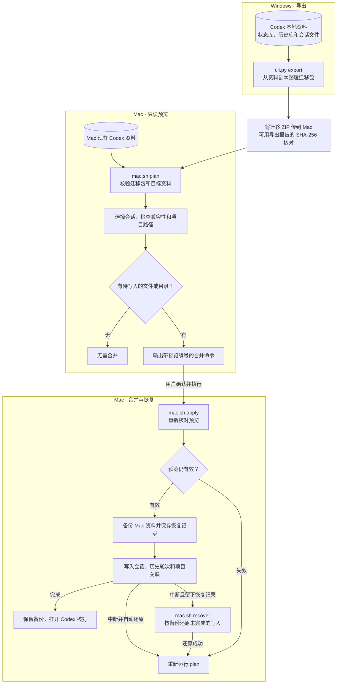

<div align="center">

# ChatLuggage

**简体中文** · [English](README.en.md)

**把 Windows 上的 Codex 聊天历史带到 Mac。**

[操作步骤](#操作步骤) · [使用场景](#使用场景) · [功能特性](#功能特性) · [迁移流程](#迁移流程) · [技术栈](#技术栈) · [项目结构](#项目结构) · [MIT 许可证](LICENSE)

</div>

## 项目简介

将 Windows 的 Codex 本地聊天和项目关联合并到 Mac，保留 Mac 原有聊天。导出、预览和合并在本地完成，两台电脑无需同时在线。

## 使用场景

| 场景 | 可以怎么做 |
| --- | --- |
| 换到 Mac 后，还要查阅旧电脑上的方案和排查记录 | 在 Windows 导出迁移 ZIP，等 Mac 准备好后再导入。 |
| 只想带走某几个月或几条聊天 | 按月份浏览会话，勾选需要迁入的聊天。 |
| 已经在 Mac 上准备好了项目代码 | 将迁入会话关联到 Mac 上已有的工作目录。[项目路径映射](docs/project-paths.md) |

## 功能特性

- **导出与校验** 在 Windows 生成迁移 ZIP 和 SHA-256 校验值，方便在 Mac 上核对传输后的文件。
- **只读预览** 合并前核对目标资料目录、选中和新增的会话数、同 ID 会话数量及项目归属。
- **备份与合并** 确认后先备份 Mac 资料，再写入选中的会话。同 ID 会话保留 Mac 上的版本。写入中断时可通过恢复流程还原。

### 迁移范围

| 会迁移 | 需要另行准备 |
| --- | --- |
| 会话正文、历史轮次、项目归属 | 项目的代码、文档和未提交的文件改动 |
| 加 `--include-assets` 时，资料目录内支持的附件、计划和生成图像 | 资料目录之外的附件、开发环境、登录和应用配置 |

## 迁移流程



## 技术栈

| 层面 | 技术 | 在项目中的用途 |
| --- | --- | --- |
| 核心逻辑 | Python 3.11+、`argparse` | 用 Python 标准库实现命令解析、会话选择、合并和恢复。 |
| 本地数据 | SQLite 3.41.0+、JSON、JSONL | 用 `sqlite3` 检查和合并 Codex 状态库与历史库。项目映射和恢复记录用 JSON，会话文件与索引用 JSONL。 |
| 迁移包 | `zipfile`、`hashlib` | 生成和读取 ZIP，用 SHA-256 校验迁移包及其中的文件。 |
| 系统入口 | Windows PowerShell、macOS Bash | Windows 在 PowerShell 中调用 `cli.py`。Mac 由 `mac.sh` 选择可用的 Python 并启动 `cli.py`。 |
| 回归测试 | `unittest` | 用虚构数据验证会话选择、兼容性、合并和中断恢复。[贡献指南](CONTRIBUTING.md) |

## 项目结构

| 位置 | 用途 |
| --- | --- |
| `cli.py` | Windows 导出入口，也负责处理 Mac 的预览、合并和恢复命令。 |
| `mac.sh` | Mac 启动脚本，选择可用的 Python 后启动 `cli.py`。 |
| `docs/` | 使用指南、项目路径映射、排障与验收说明。 |
| `tests/` | 用虚构数据检查导出、合并、兼容性和中断恢复。 |
| `tools/` | 构建和检查下载 ZIP，运行发布验收。 |

## 操作步骤

当前版本为 **0.1.0-rc.16**。需要 Python 3.11 或更新版本，以及它加载的 SQLite 3.41.0 或更新版本。启动命令会寻找本机已有的合适解释器。[检查 Python](docs/usage.md#检查-python)

**已经有 Windows 导出的聊天迁移 ZIP？** 先在 Mac 完成[第 1 步](#1-下载并解压项目)，然后跳到[第 3 步](#3-在-mac-预览)。

### 1. 下载并解压项目

在 GitHub 仓库首页点 **Code → Download ZIP** 下载工具 ZIP。Windows 导出和 Mac 导入各使用一份解压后的工具。

- **Windows** 右键点击工具 ZIP，选 **全部解压缩**，再打开解压出来的项目文件夹。继续往里找，直到在同一层看到 `README.md`、`cli.py` 和 `docs/`。Windows 隐藏文件后缀时，前两个文件显示为 `README` 和 `cli`。
- **Mac** 在访达里双击工具 ZIP，打开同时包含 `cli.py`、`mac.sh` 和 `docs/` 的那层文件夹。如果拿到的是带 `START-HERE.txt` 的交接包，打开与它同层的 `codex-history-migration/`。[Mac 解压排障](docs/usage.md#mac-解压遇到问题)

### 2. 在 Windows 导出聊天

打开 Windows **开始菜单**，搜索并打开 **Windows PowerShell**。

在文件资源管理器里打开上一步的项目文件夹，复制顶部地址栏中的完整路径。回到 PowerShell，用 `cd` 进入这个文件夹。下面是示例，把引号里的路径换成刚复制的实际路径，保留英文双引号，按回车：

```powershell
cd "D:\下载\codex-history-migration"
```

保存工作并退出 Windows 上的 ChatGPT/Codex，保留这个 PowerShell 窗口。在里面粘贴下面的命令并按回车：

```powershell
python -B .\cli.py export .\Codex-Windows-History.zip
```

程序会显示正在读取的资料目录和处理进度。ZIP 写完并校验通过后，终端会显示 **“导出成功”**、文件位置和 SHA-256。回到项目文件夹按 **F5** 刷新，就能找到 `Codex-Windows-History.zip`。隐藏后缀时它会显示为 `Codex-Windows-History`。

把导出成功的 **聊天迁移 ZIP** 传到 Mac 的「下载」文件夹，保持压缩状态。这份 ZIP 含有你的聊天，请单独保管。传完可以核对 Windows 导出时显示的 SHA-256。[迁移包校验方法](docs/usage.md#检查迁移包和兼容性)

如果出现“操作已停止”，先看提示中的具体路径和原因。常见情况见[使用指南](docs/usage.md)：Python 无法运行、目录不正确、输出 ZIP 已存在、资料文件被占用。失败时不要继续 Mac 合并步骤。

### 3. 在 Mac 预览

在访达中找到解压后同时含有 `mac.sh` 和 `cli.py` 的文件夹。右键点**文件夹本身**，在「服务」里选「新建位于文件夹位置的终端窗口」。这样打开的终端已经在正确的位置，文件夹名称带空格或数字也可以。

如果菜单里没有这一项，打开「终端」，输入 `cd`，**按一下空格键**，再把文件夹拖进终端，最后按回车。比如文件夹叫 `codex-history-migration 3`，对应的整行命令是 `cd "$HOME/Downloads/codex-history-migration 3"`。

Mac 上需要已有 Codex 本地资料。保存工作，在 ChatGPT/Codex 中按 **⌘Q** 退出，并关闭其他终端中运行的 Codex CLI。保留用于迁移的「终端」窗口。[检查目标资料目录](docs/usage.md#指定资料目录和附件)

在终端输入 `/bin/bash ./mac.sh plan`，末尾按一下空格。把第 2 步传来的**实际聊天迁移 ZIP** 从访达拖进这一行，核对文件名后再按回车。例如要迁移的文件叫 `Codex-Windows-History (2).zip`，拖入的路径就应带上 `(2)`。手上已有迁移包时，也按这个方法选取。

如果文件以原名 `Codex-Windows-History.zip` 保存在「下载」中，可以直接运行下面的命令。

```bash
/bin/bash ./mac.sh plan "$HOME/Downloads/Codex-Windows-History.zip"
```

终端会显示所用的 Python 版本，然后按聊天开始的月份列出数量，并标出每月有几条已经在 Mac 上。看到选择提示后，输入一个数字并按回车。

| 你要做什么 | 在终端怎么选 |
| --- | --- |
| 导入全部聊天 | 输入 `1`，直接看预览结果。 |
| 导入某几个月 | 输入 `2`，再输入屏幕上的月份编号，例如 `1,3`。在聊天列表输入 `a` 并按回车，选定这些月份的全部聊天。 |
| 只导入几条聊天 | 输入 `2`，选择月份（输入 `a` 可浏览所有月份）。列表会显示日期、项目、标题和编号。输入聊天编号，例如 `2,4-6`，回车勾选；再按一次回车确认。`n` / `p` 可翻页，同一编号再输一次可取消勾选。 |
| 退出预览 | 在选择菜单输入 `0`。 |

编号以屏幕上的列表为准。确认选择后，核对目标资料目录、选中数、新增数、同 ID 保留数和项目目录。预览以只读方式检查资料，可以先停在这里。

如果要在 Mac 继续开发，请先复制或克隆项目文件，再用项目路径映射重新预览。未映射的新项目会使用空的占位目录。[项目路径映射](docs/project-paths.md)

### 4. 确认并合并

有待写入内容时，预览结果末尾会显示一条完整的合并命令。确认后，**把输出里的整条命令复制到同一个终端，按回车**。这条命令会沿用选中的聊天、预览编号、目标目录和路径映射，无需手动拼接。保持 Codex 退出，等待完成。

看到 **“合并完成”** 后，记下并保留输出中的备份，再打开平时使用的 Codex。核对原有会话和迁入会话的正文、迁入会话的项目归属和当前工作目录。

如果显示“无需合并”，表示本次没有待写入的文件。同 ID 会话保留 Mac 原有版本。预览后重新打开 Codex、修改资料或路径映射，都可能使预览失效，此时重新运行 `plan` 即可。

若合并中断，按提示使用 `recover` 恢复未完成的安装，具体见[中断恢复](docs/usage.md#合并中断后恢复)。`recover` 不用于撤销已经成功完成的合并。

开发、测试及构建下载包的说明见 [CONTRIBUTING](CONTRIBUTING.md)。
